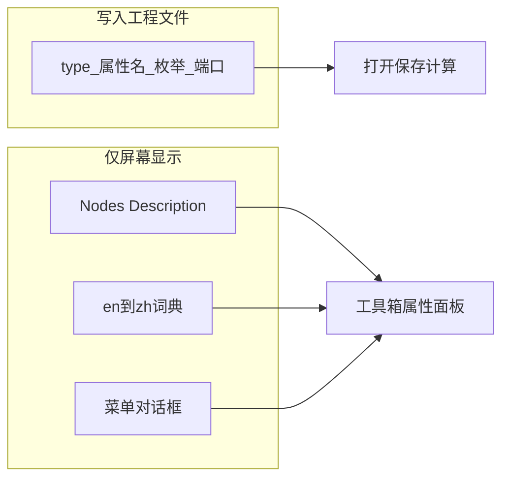

# Gaea 2 中文显示汉化计划

## 目标与红线

- **目标**：界面显示中文；工程打开/保存/计算行为与英文版一致。
- **安装路径**：`D:\Program Files\Gaea 2`（约 2.3.0.1，.NET 8 WPF + Unity 视口）。
- **工作区**：`d:\Projects\Gaea-CN`

**禁止写入中文（避免坏档）的字段：**

- `.terrain` 中的 `$type`、属性键（如 `Downcutting`）、枚举值（如 `High`）、端口名（`In`/`Out`）
- `Resources\Nodes.json` 顶层节点 `Name`、`EnumValue` 的 `Name`、与序列化属性同名的 `Flub.Name`
- 收藏夹等配置里的英文节点 ID（如 `Erosion2`）

**允许汉化：** 所有 `Description`；菜单/对话框等纯展示文案；带空格的参数**显示标签**仅通过 en→zh 映射覆盖显示，不改变持久化键。



## 技术事实（已验证）

- 官方无 Gaea 中文包；`de`/`fr`/`sv` 仅为 Spectre.Console 附属资源。
- 节点元数据在 `Resources\Nodes.json`（182 节点；说明类文本可安全汉化）。
- `.terrain` 为 JSON，节点以 `$type: QuadSpinner.Gaea.Nodes.*` 持久化；实例 `"Name": "Mountain"` 等为英文。
- 壳层 UI 字符串嵌在混淆后的 `Gaea.dll` 等程序集中，不适合作等长二进制改字。

## 选定实现路径

采用 **显示层词典 + 分阶段覆盖**，不把标识符改成中文写回磁盘。

### 阶段 0：仓库与安全底座

在 `Gaea-CN` 建立：

- `dict/` — 翻译词典
- `tools/` — 抽取/应用/还原脚本
- `overlays/` — 生成的覆盖文件
- `docs/glossary.md`、`docs/safety-rules.md`

安装前备份 `Resources\Nodes.json`；`apply` / `restore` 脚本负责写入与回滚（可能需管理员权限）。

### 阶段 1：节点说明汉化（首期交付）

- 只改 `Description`（节点 + Flub/枚举说明），**全部 `Name` 保持英文**。
- 工具：从原版 `Nodes.json` 抽取 → `dict/nodes.descriptions.zh.json` → 生成 `overlays/Nodes.json` → 覆盖安装目录 Resources。
- 验收：官方 Example `.terrain` 打开 → 改参数 → 保存 → 再开；节点类型与计算正常。

### 阶段 2：参数显示标签（受控）

- 词典键 = 英文 `Flub.Name`，值 = 中文标签。
- 仅覆盖明显展示用文案（如含空格的 `Restrict to Group`）；枚举值 `Name` 永不改。
- 与阶段 3 的显示替换共用同一套查找表更稳妥。

### 阶段 3：壳层 UI（菜单/对话框）

- 从 `Gaea.dll` 等抽取可见英文字符串 → `dict/ui.shell.zh.json`。
- 用 **WPF 启动时显示层注入**（按英文原文替换为中文），不碰序列化路径。
- 不做 DLL 等长字符串补丁。

### 阶段 4：维护

- 术语表统一（Erosion / Sediment / Mask 等）。
- 锁定 Gaea 2.3.x；升级后重跑抽取与 diff。
- 一键 apply/restore；回归用例：官方 Example + 用户自有工程。

## 仓库结构（落地）

```
Gaea-CN/
  dict/
    nodes.descriptions.zh.json
    flubs.labels.zh.json
    ui.shell.zh.json
  tools/
    extract_nodes.py
    seed_sample_zh.py
    build_overlay.py
    apply_overlay.ps1
    restore_overlay.ps1
    extract_ui_strings.ps1
    verify_terrain_roundtrip.py
  overlays/
    Nodes.json
  backups/
    Nodes.json.bak
  docs/
    glossary.md
    safety-rules.md
    PLAN.md
```

## 常用命令

```powershell
# 从安装目录抽取可译 Description 骨架
python tools/extract_nodes.py

# 写入首批高频节点中文（可重复运行，按 en 对齐保留已有 zh）
python tools/seed_sample_zh.py

# 将词典合并进原版 Nodes.json，写出 overlays/Nodes.json
python tools/build_overlay.py

# 备份并覆盖安装目录（可能需要管理员权限）
powershell -ExecutionPolicy Bypass -File tools/apply_overlay.ps1

# 从备份还原
powershell -ExecutionPolicy Bypass -File tools/restore_overlay.ps1

# 对官方 Example 做保存语义回归（不启动 GUI）
python tools/verify_terrain_roundtrip.py
```
